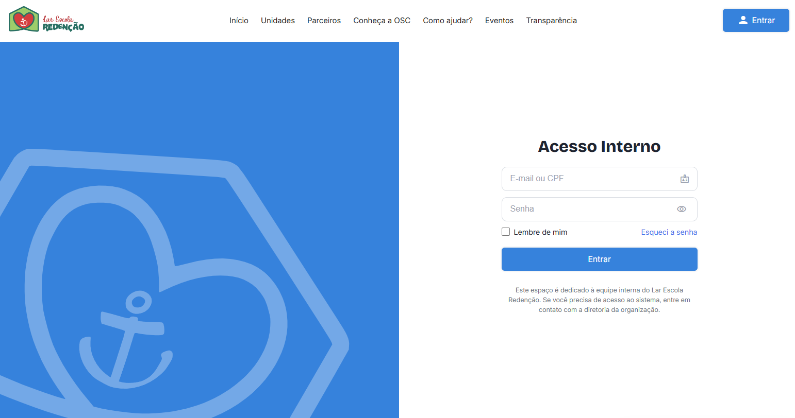
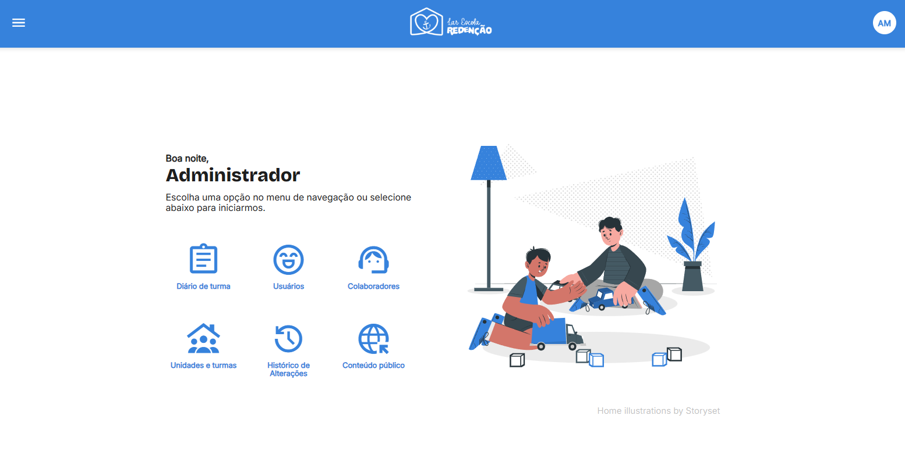

# Lar Escola Redenção | Front-end

Interface web do sistema de gestão operacional e institucional desenvolvido para o **Lar Escola Redenção**, organização da sociedade civil sem fins lucrativos de Araraquara (SP). O projeto é realizado por sete estudantes do curso de Tecnologia em Sistemas para Internet do Instituto Federal de São Paulo (IFSP), Campus Araraquara, como atividade acadêmica de extensão.

O sistema reúne um portal institucional e uma área de uso interno. Seu desenvolvimento parte de necessidades levantadas com a instituição, que utiliza diferentes recursos e procedimentos manuais para organizar informações de atendimento e divulgar suas atividades.

**Estado do projeto:** em desenvolvimento, com entrega prevista para o final de 2026. Uma versão parcial está disponível em ambiente reservado à instituição.

## Sobre a instituição

Fundado em **29 de agosto de 1978**, o Lar Escola Redenção atende crianças e adolescentes em situação de vulnerabilidade social por meio de atividades educacionais, culturais e esportivas, além de ações de convivência e acompanhamento familiar. Sua atuação abrange a sede no bairro São José, o Núcleo Bezerra de Menezes e o projeto SOS Bombeiros no Resgate da Cidadania.

Mais informações sobre a trajetória da entidade estão disponíveis no [verbete Lar Escola Redenção, na Wikipédia](https://pt.wikipedia.org/wiki/Lar_Escola_Reden%C3%A7%C3%A3o).

## Funcionalidades do sistema

**Área pública**

- Informações sobre a instituição e suas unidades de atendimento.
- Divulgação de parceiros, eventos e atividades.
- Orientações sobre formas de apoio e acesso a documentos de transparência.

**Área interna**

- Acesso de colaboradores com diferentes perfis e permissões.
- Organização de unidades, turmas, cadastros e matrículas.
- Rotinas de acompanhamento, incluindo frequência e ocorrências.
- Recursos de consulta a históricos e emissão de relatórios.
- Administração do conteúdo apresentado no portal público.

Esses itens descrevem o escopo do produto. A implementação e os testes são realizados de forma incremental, portanto a presença de uma funcionalidade nesta lista não significa que ela já tenha sido concluída ou validada.

A integração de pagamentos para doações e a divulgação estruturada dos serviços da gráfica da instituição são possibilidades de evolução posteriores à primeira versão.

## Capturas de tela

Imagens da interface durante o desenvolvimento, sem dados pessoais de assistidos ou familiares.

### Acesso interno



### Painel administrativo



O endereço do ambiente de treinamento não é divulgado neste repositório.

## Tecnologias

- Angular e TypeScript para a interface.
- API REST desenvolvida em Java e Spring Boot.
- MySQL para persistência dos dados da aplicação.
- Git e GitHub para versionamento e organização do desenvolvimento.

O código da API e as regras de negócio estão no repositório [Lar-Escola-Redencao/back-end](https://github.com/Lar-Escola-Redencao/back-end).

## Desenvolvimento local

Para instalar as dependências do front-end:

```bash
git clone https://github.com/Lar-Escola-Redencao/front-end.git
cd front-end
npm install
npm run
```

O último comando lista os scripts disponíveis no `package.json`. A execução de algumas páginas também depende da configuração de uma API local.

## Contexto acadêmico

O trabalho integra atividades de extensão do IFSP, articulando desenvolvimento de software e demandas reais de uma organização social. A equipe utiliza práticas de engenharia de software, levantamento de requisitos, organização por sprints e acompanhamento de entregas inspirado no Scrum.

A experiência também está sendo sistematizada em um **relato acadêmico em elaboração**, com discussão sobre a colaboração entre instituição e estudantes e o aporte teórico de Edgar Morin. O texto é preparado para possível submissão à revista *Extensão em Foco*; ainda não é uma publicação concluída.

## Privacidade

O projeto envolve processos que podem conter dados pessoais de menores de idade. Não publique informações reais de assistidos ou familiares em issues, exemplos, capturas de tela ou ambientes de demonstração.

## Licença

Este repositório é disponibilizado sob a [licença MIT](LICENSE).

## English summary

Open-source web interface developed by seven IFSP students for Lar Escola Redenção, a nonprofit organization in Araraquara, Brazil. The application combines a public institutional portal with an internal management system. Development is ongoing; institutional testing and final delivery are planned for later in 2026.
